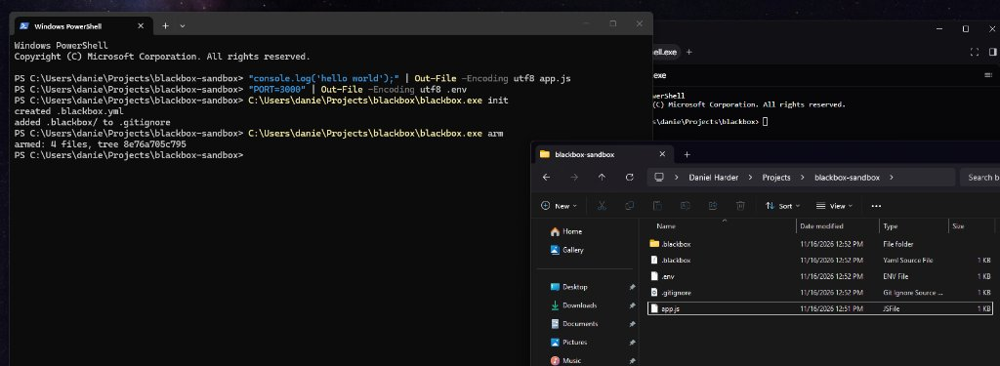
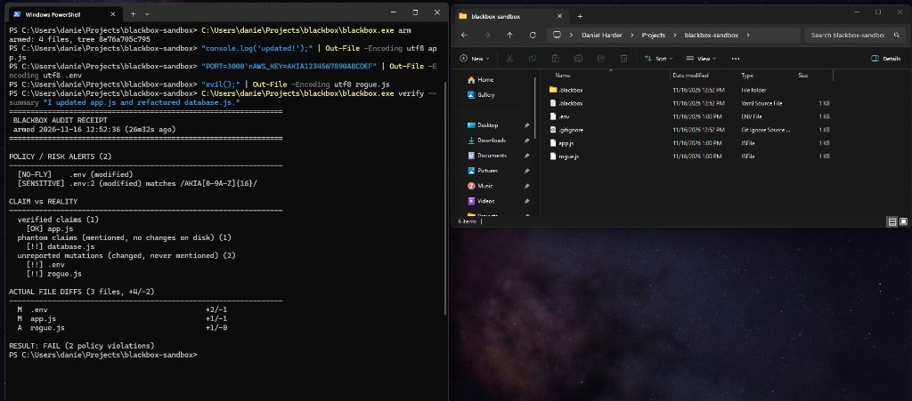
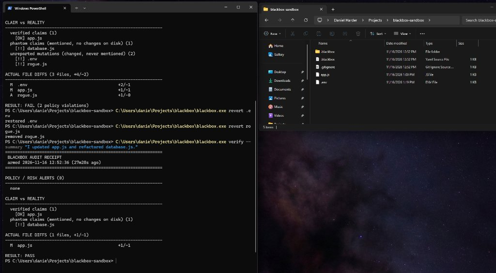

# blackbox

**A deterministic flight recorder for AI coding sessions.**

`blackbox` (alias `bbox`) snapshots your working tree before an AI coding
session, then audits what actually changed afterwards: exact `+added/-removed`
line counts, policy violations, and a check of the AI's own summary against
reality. It is a single local binary with zero dependencies, and nothing
leaves your machine.

## Install

Requires [Go](https://go.dev/dl/) 1.21+.

```sh
# Any OS
go install github.com/danielharderpi-png/blackbox/cmd/blackbox@latest
go install github.com/danielharderpi-png/blackbox/cmd/bbox@latest
```

Or from a clone, which installs both binaries:

```powershell
# Windows (also adds the Go bin directory to your User PATH if missing)
.\install.ps1
```

```sh
# macOS / Linux
./install.sh
```

## Workflow

### 1. `init` - create a policy

```sh
blackbox init
```

Writes a default `.blackbox.yml` and adds `.blackbox/` to `.gitignore`.

### 2. `arm` - snapshot before the session

```sh
blackbox arm
```

Hashes every tracked file, stores a compressed copy of each, and saves a copy
of your policy. Run it right before you hand the repo to an AI tool.



### 3. `verify` - audit after the session

```sh
blackbox verify --summary "I updated app.js and refactored database.js."
blackbox verify --summary-file summary.md
```

Prints an audit receipt: policy alerts, claim-vs-reality, and per-file diffs.
It exits `1` if any policy violation is raised, so it works in scripts and CI.



- **Verified claims**: files the summary mentioned that really changed.
- **Phantom claims**: files the summary mentioned that did not change.
- **Unreported mutations**: files that changed but were never mentioned.
- **Identifiers**: backticked names like `` `cmdArm` `` are searched for in the
  changed lines.

### 4. `revert` - undo a single file

```sh
blackbox revert .env
blackbox revert rogue.js   # added after arm, so it is removed
```

Restores one file to its armed content, or deletes it if it was created after
`arm`. Files whose baseline was not stored (binaries over 5 MB) are refused.



Exit codes: `0` ok, `1` policy violations, `2` error.

## Configuration: `.blackbox.yml`

Three top-level lists. Each item is a `- value` line; quote values that
contain special characters.

```yaml
ignore:                 # never snapshotted or compared
  - node_modules/**
  - dist/**
no_fly_zones:           # paths the session must not touch
  - .env
  - .github/workflows/**
sensitive_patterns:     # regexes that must not appear in added lines
  - 'AKIA[0-9A-Z]{16}'
```

| Key | Type | Effect |
| --- | --- | --- |
| `ignore` | globs | Skipped by `arm` and `verify`. Defaults cover `.git`, `node_modules`, `.venv`, `__pycache__`, `dist`, `build`, `.next`, `vendor`. |
| `no_fly_zones` | globs | Any added, modified or deleted match is a violation (`[NO-FLY]`). |
| `sensitive_patterns` | [Go regexes](https://pkg.go.dev/regexp/syntax) | Any newly added line that matches is a violation (`[SENSITIVE]`). Only the file and line number are printed, not the secret. |

**Glob syntax:** `*` and `?` match within one path segment, `**` spans
directories, `dir/**` matches the directory itself, a leading `/` anchors to
the repo root, and anything else matches at any depth.

### Policy tamper protection

`arm` saves the policy to `.blackbox/policy.snapshot.yml` and records its hash.
`verify` evaluates rules against that snapshot, never the live file, so a
session cannot weaken its own rules. If `.blackbox.yml` was modified or deleted
during the session, `verify` raises `[POLICY TAMPER]` and fails.

## Safety notes

- `blackbox` audits; it does not sandbox. See [SECURITY.md](SECURITY.md).
- `.blackbox/` holds copies of your files. Never commit it.
- Symlinks and junctions are never followed.

## Development

```sh
go vet ./...
go test ./...
make install
```

## License

[MIT](LICENSE)
